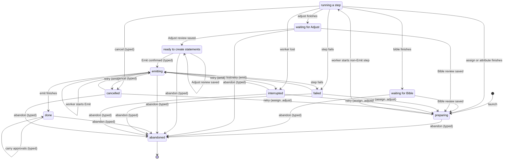
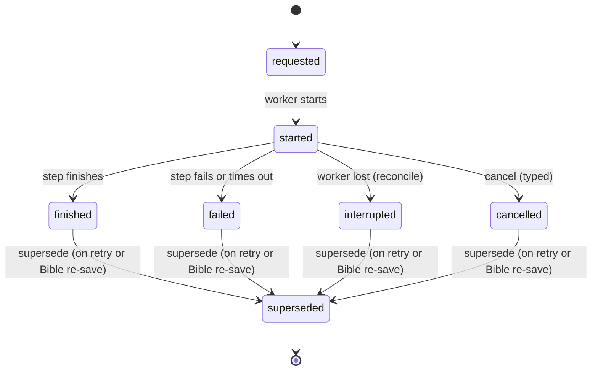

<!-- GENERATED FILE: DO NOT EDIT BY HAND. -->
<!-- Source: src/state-machine/coherence-machines.mjs | Checksum: 41b2e900ada47eef08ce1627cdebe59dff30bb8272865d0a178f03385552adc1 -->

# Coherence State Machines

Generated directly from `src/state-machine/coherence-machines.mjs` using the reusable declarative state-machine pattern in `src/state-machine/declarative-machine.mjs`. Every state listed here is proven reachable, every guard is verified against live PostgreSQL 17 triggers and constraints, and `npm test` fails if this document drifts from the code.

| Machine | ID | States | Transitions | Guards | Spec SHA-256 |
|---|---|---|---|---|---|
| Run Lifecycle (Derived Stages) | `coherence-run-stage` | 11 | 18 | 16 | `ec2eb9c9a7971da6` |
| Step Attempt Lifecycle | `coherence-step-attempt` | 7 | 6 | 10 | `eaa47e3d656b4ae4` |

---

## Run Lifecycle (Derived Stages) (`coherence-run-stage`)

The 11 derived stages of a Coherence run (computed from immutable events by `coherence.run_stage(run_id, as_of_seq)` and never stored as mutable state). Every guard is enforced directly inside PostgreSQL triggers.

- Version: `1.0.0` | Storage: derived (never stored) | Requirements: R8, R9.4, R10, R11 | Spec SHA-256: `ec2eb9c9a7971da6`

### States

| State | Kind | Description | Derivation / Rule |
|---|---|---|---|
| `no open run of the date` | entry (pseudo) | No non-abandoned run exists for the target statement date. | — |
| `preparing` | active | A non-Emit step (`assign`, `attribute`, `bible`, `adjust`) has an open unanswered request awaiting the worker. | No abandonment, no open attempt, and an open `step_request` for a non-Emit step (or initial fallback). |
| `running a step` | active | The worker is actively executing `assign`, `attribute`, `bible`, or `adjust`. | Open un-ended `started` attempt for `assign`, `attribute`, `bible`, or `adjust`. |
| `waiting for Bible` | active | Human review pause after `bible` finished; Adjust never runs until a Bible review is saved. | Non-superseded finished `bible` attempt, no Adjust finished, no open request/attempt. |
| `waiting for Adjust` | active | Human review pause after `adjust` finished; waiting for an Adjust review save (or allowed Bible re-save). | Non-superseded finished `adjust` attempt with no Adjust `review_save` for that attempt. |
| `ready to create statements` | active | At least one Adjust review has been saved for Adjust's current attempt; awaiting typed Emit confirmation. | Non-superseded finished `adjust` attempt with an Adjust `review_save` for that attempt, and no open Emit request/attempt. |
| `emitting` | active | Emit has been confirmed (queued or actively running on the worker). | Open `emit` step request OR open un-ended `started` attempt for `emit`. |
| `done` | active | Emit finished cleanly; outputs are ready to inspect and (for `app` / `company_import`) carry. | Non-superseded finished `emit` attempt, not abandoned, no open request/attempt. |
| `failed` | active | The latest non-superseded ended attempt ended in `failed` (exit non-zero, timeout, or verification error). | Highest-rank non-superseded ended attempt has `event_kind = failed`. |
| `interrupted` | active | The worker died or lost its PostgreSQL slot mid-step and the reconciler marked the attempt `interrupted`. | Highest-rank non-superseded ended attempt has `event_kind = interrupted`. |
| `cancelled` | active | A human issued a typed cancel and the worker stopped the step process group. | Highest-rank non-superseded ended attempt has `event_kind = cancelled`. |
| `abandoned` | terminal | A person gave up an uncarried, non-running run with a typed decision and reason; no further mutations allowed. | Row exists in `coherence.abandonments` for this `run_id`. |

### Transitions

| Transition | Action | From | To | Actors | Guards | Effects |
|---|---|---|---|---|---|---|
| `launch` | launch | `no open run of the date` | `preparing` | `owner`, `nusear_staff` | `no_sent_statement_for_date`, `no_non_abandoned_run_for_date` | create run; request assign (reason=launch) |
| `worker_starts_step` | worker starts non-Emit step | `preparing` | `running a step` | `worker` | `worker_holds_slot` | record started event for assign/attribute/bible/adjust |
| `worker_starts_emit` | worker starts Emit | `emitting` | `emitting` | `worker` | `worker_holds_slot` | record started event for emit |
| `step_finishes_continue` | assign or attribute finishes | `running a step` | `preparing` | `worker` | `same_starter_slot_no_end` | record finished event with artifacts; request next step (attribute or bible) |
| `step_finishes_bible` | bible finishes | `running a step` | `waiting for Bible` | `worker` | `same_starter_slot_no_end` | record finished event for bible; pause for human Bible review |
| `step_finishes_adjust` | adjust finishes | `running a step` | `waiting for Adjust` | `worker` | `same_starter_slot_no_end` | record finished event for adjust; pause for human Adjust review |
| `step_finishes_emit` | emit finishes | `emitting` | `done` | `worker` | `same_starter_slot_no_end` | record finished event for emit with statements and bundles |
| `step_fails` | step fails | `running a step`, `emitting` | `failed` | `worker` | `same_starter_slot_no_end` | record failed event with log |
| `worker_lost` | worker lost | `running a step`, `emitting` | `interrupted` | `worker` | `slot_free_or_other_holder_no_end` | record interrupted event |
| `cancel` | cancel (typed) | `running a step`, `emitting` | `cancelled` | `owner`, `nusear_staff`, `worker` | `open_attempt_and_typed_cancel`, `same_starter_slot_no_end` | record cancel_request; stop engine process group; record cancelled event |
| `bible_review_saved` | Bible review saved | `waiting for Bible`, `waiting for Adjust` | `preparing` | `owner`, `nusear_staff`, `worker` | `no_open_request_not_abandoned`, `no_adjust_save_for_current_adjust`, `overlay_extends_frozen_prior` | record review_save (bible); delete bible draft; supersede prior Adjust attempt if any; request adjust (reason=bible_saved) |
| `adjust_review_saved` | Adjust review saved | `waiting for Adjust`, `ready to create statements` | `ready to create statements` | `owner`, `nusear_staff`, `worker` | `no_open_request_not_abandoned`, `no_emit_confirmed_for_current_adjust`, `overlay_extends_frozen_prior`, `overlay_extends_bible_save` | record review_save (adjust); delete adjust draft |
| `emit_confirmed` | Emit confirmed (typed) | `ready to create statements` | `emitting` | `owner` | `no_open_request_not_abandoned`, `emit_typed_phrase_and_newest_save` | record emit_confirmation; request emit (reason=emit_confirmed) |
| `retry_non_emit` | retry (assign..adjust) | `failed`, `interrupted`, `cancelled` | `preparing` | `owner`, `nusear_staff` | `no_open_request_not_abandoned`, `retry_guards` | supersede later attempts if any; request step (reason=retry) |
| `retry_emit` | retry (emit) | `failed`, `interrupted`, `cancelled` | `emitting` | `owner`, `nusear_staff` | `no_open_request_not_abandoned`, `retry_guards` | request emit (reason=retry) keeping original emit_confirmation |
| `record_as_sent` | record as sent (typed) | `done` | `done` | `owner` | `carry_sent_guards` | record sent carry; publish next standing input version adding Sent/statements_<date>.csv |
| `carry_approvals` | carry approvals (typed) | `done` | `done` | `owner` | `carry_approvals_guards` | record approvals carry; publish next standing input version with Overlay/overlay.csv (or nothing_new=true) |
| `abandon` | abandon (typed) | `preparing`, `waiting for Bible`, `waiting for Adjust`, `ready to create statements`, `emitting`, `done`, `failed`, `interrupted`, `cancelled` | `abandoned` | `owner` | `abandon_guards` | record abandonment; delete review drafts |

### Guards and Database Enforcement

| Guard | Requirement | Rule | Database Enforcement |
|---|---|---|---|
| `no_sent_statement_for_date` | R8, R9.4 | No sent statement exists for this statement date (a correction belongs to a later date). | table `coherence.runs`; trigger `trg_02_runs_before` |
| `no_non_abandoned_run_for_date` | R8, R9.4 | No non-abandoned run of the same origin exists for this date (a finished uncarried run must be abandoned first). | table `coherence.runs`; trigger `trg_02_runs_before` |
| `worker_holds_slot` | R8, R9.6 | Worker holds the company running slot advisory lock, predecessor finished, request open and matching. | table `coherence.step_attempt_events`; trigger `trg_02_step_attempt_events_before` |
| `same_starter_slot_no_end` | R8, R10.2 | Still holds the slot on the attempt starter connection and attempt has no end event yet. | table `coherence.step_attempt_events`; trigger `trg_02_step_attempt_events_before` |
| `slot_free_or_other_holder_no_end` | R8, R10.1 | Slot is free or held by a different backend than the starter, and attempt has no end event yet. | table `coherence.step_attempt_events`; trigger `trg_02_step_attempt_events_before` |
| `open_attempt_and_typed_cancel` | R6.9, R8 | Run has an open attempt and cancel carries the typed phrase `"cancel <date>"`. | table `coherence.cancel_requests`; trigger `trg_02_cancel_requests_before` |
| `no_open_request_not_abandoned` | R8, R9.4 | No open step request, no open attempt, and run is not abandoned. | table `coherence.review_saves`; trigger `trg_02_review_saves_before` |
| `no_adjust_save_for_current_adjust` | R8, R11 (CR-8) | No Adjust review has been saved for Adjust's current non-superseded attempt (CR-8). | table `coherence.review_saves`; trigger `trg_02_review_saves_before` |
| `overlay_extends_frozen_prior` | R5.5, R8, R10.7 | Coherence overlay check passed and file begins with the run's frozen prior approvals. | table `coherence.review_saves`; trigger `trg_02_review_saves_before` |
| `no_emit_confirmed_for_current_adjust` | R8, R11 (CR-1) | No Emit confirmation exists for Adjust's current attempt (CR-1). | table `coherence.review_saves`; trigger `trg_02_review_saves_before` |
| `overlay_extends_bible_save` | R5.5, R8 | Adjust approvals file begins with this run's saved Bible review. | table `coherence.review_saves`; trigger `trg_02_review_saves_before` |
| `emit_typed_phrase_and_newest_save` | R5.4, R6.17, R8, R9.4, R11 (CR-1) | Typed phrase is `"create statements for <date>"`, names this run's newest Adjust save, and no review submission is waiting (CR-1). | table `coherence.emit_confirmations`; triggers `trg_02_emit_confirmations_before`, `trg_emit_confirmations_verify_deferred` |
| `retry_guards` | R6.8, R8, R9.4 | A person asks to retry a failed/interrupted/cancelled step; later attempts are superseded; Emit retry keeps its valid confirmation. | table `coherence.step_requests`; trigger `trg_02_step_requests_before` |
| `carry_sent_guards` | R6.18, R7.6, R8, R9.4 | Run is `app` or `company_import` in stage `done`; file matches this run's finished Emit statement; at most one sent statement per date; typed phrase `"sent <date>"`. | table `coherence.carries`; trigger `trg_02_carries_before`; indexes `coherence.carries_one_sent_per_date` |
| `carry_approvals_guards` | R6.18, R7.6, R8, R9.4, R11 (S-8) | Run is `app` or `company_import` in stage `done`; file matches this run's finished Emit `emits/overlay.csv`; extends current standing approvals file (S-8); typed phrase `"carry <date>"`. | table `coherence.carries`; trigger `trg_02_carries_before` |
| `abandon_guards` | R6.19, R8, R9.4 | No open attempt, no review submission waiting, nothing carried, non-imported run, typed phrase `"abandon <date>"` and non-empty reason. | table `coherence.abandonments`; triggers `trg_02_abandonments_before`, `trg_03_abandonments_delete_drafts` |

### State Diagram

---

## Step Attempt Lifecycle (`coherence-step-attempt`)

Lifecycle of a single numbered attempt of one Coherence step (`assign`, `attribute`, `bible`, `adjust`, `emit`). Attempts are numbered strictly in order, have at most one start and at most one end, and may be superseded only after an end.

- Version: `1.0.0` | Storage: event-sourced lifecycle | Requirements: R6.8, R6.10, R8, R9.4, R9.6, R10.1, R10.2 | Spec SHA-256: `eaa47e3d656b4ae4`

### States

| State | Kind | Description | Derivation / Rule |
|---|---|---|---|
| `requested` | initial | An open `step_requests` row awaits the company engine worker. | Row in `coherence.step_requests` with no matching `started` event in `step_attempt_events`. |
| `started` | active | The worker acquired the company running slot and recorded `event_kind = started` bound to `(slot_backend_pid, slot_backend_start)`. | `started` event present with no terminal end event (`finished`, `failed`, `interrupted`, `cancelled`). |
| `finished` | active | The step exited 0, marked `run.json`, kept frozen input unchanged, and committed all verified artifacts on the starter slot connection. | `event_kind = finished` recorded on the exact slot connection that started the attempt. |
| `failed` | active | The step exited non-zero, timed out at 15 minutes, failed input verification, or lacked its `run.json` mark. | `event_kind = failed` recorded with log fingerprint on the starter slot connection. |
| `interrupted` | active | The worker or its PostgreSQL connection died before recording an end; the reconciler closed the open attempt. | `event_kind = interrupted` recorded when slot is free or held by a different backend than the attempt starter. |
| `cancelled` | active | A human issued a typed cancel request and the worker terminated the step process group. | `event_kind = cancelled` linked to `cancel_requests` on the starter slot connection. |
| `superseded` | terminal | A later retry or Bible re-save replaced this ended attempt; preserved forever in history. | `event_kind = superseded` recorded strictly after an end event. |

### Transitions

| Transition | Action | From | To | Actors | Guards | Effects |
|---|---|---|---|---|---|---|
| `worker_start` | worker starts | `requested` | `started` | `worker` | `worker_holds_slot`, `no_company_open_attempt`, `predecessor_step_finished`, `request_open_and_matching` | record started event with (slot_backend_pid, slot_backend_start) |
| `step_finish` | step finishes | `started` | `finished` | `worker` | `same_slot_starter_connection`, `no_end_yet` | record finished event with census, born (assign), artifacts; request next step if assign/attribute |
| `step_fail` | step fails or times out | `started` | `failed` | `worker` | `same_slot_starter_connection`, `no_end_yet` | record failed event with log fingerprint and redacted summary |
| `worker_lost_interrupt` | worker lost (reconcile) | `started` | `interrupted` | `worker` | `slot_free_or_other_holder`, `no_end_yet` | record interrupted event so run is no longer running |
| `step_cancel` | cancel (typed) | `started` | `cancelled` | `owner`, `nusear_staff`, `worker` | `same_slot_starter_connection`, `no_end_yet`, `cancel_request_matches` | stop engine process group; record cancelled event linked to cancel_request |
| `supersede_after_end` | supersede (on retry or Bible re-save) | `finished`, `failed`, `interrupted`, `cancelled` | `superseded` | `owner`, `nusear_staff`, `worker` | `attempt_already_ended`, `not_carried_emit` | record superseded event so later attempt becomes current |

### Guards and Database Enforcement

| Guard | Requirement | Rule | Database Enforcement |
|---|---|---|---|
| `worker_holds_slot` | R8, R9.6 | Current PostgreSQL session holds the company running slot advisory lock. | table `coherence.step_attempt_events`; trigger `trg_02_step_attempt_events_before` |
| `no_company_open_attempt` | R10.1 | No dead/open attempt exists anywhere in the company database (reconcile first). | table `coherence.step_attempt_events`; trigger `trg_02_step_attempt_events_before` |
| `predecessor_step_finished` | R7.3, R8 | Predecessor step (`assign -> attribute -> bible -> adjust -> emit`) has a non-superseded finished attempt. | table `coherence.step_attempt_events`; trigger `trg_02_step_attempt_events_before` |
| `request_open_and_matching` | R7.4, R8 | Referenced `step_request` exists, belongs to this `(run, step)`, and has not been answered. | table `coherence.step_attempt_events`; trigger `trg_02_step_attempt_events_before`; indexes `coherence.sae_one_start`, `coherence.sae_one_start_per_request` |
| `same_slot_starter_connection` | R8, R10.2 | Current connection still holds the slot AND matches the attempt starter `(slot_backend_pid, slot_backend_start)`. | table `coherence.step_attempt_events`; trigger `trg_02_step_attempt_events_before` |
| `no_end_yet` | R8 | Attempt has no existing end event (`finished`, `failed`, `interrupted`, `cancelled`). | table `coherence.step_attempt_events`; trigger `trg_02_step_attempt_events_before`; indexes `coherence.sae_one_end` |
| `slot_free_or_other_holder` | R8, R10.1 | Company running slot is free, OR held by a different backend connection than the attempt starter (dead worker replaced). | table `coherence.step_attempt_events`; trigger `trg_02_step_attempt_events_before` |
| `cancel_request_matches` | R6.9, R8 | Optional `cancel_request_id` matches `(run_id, step, attempt_no)` and was authorized with typed phrase. | table `coherence.cancel_requests`; trigger `trg_02_cancel_requests_before` |
| `attempt_already_ended` | R6.10, R8 | Attempt has an end event (`finished`, `failed`, `interrupted`, `cancelled`) and has not already been superseded. | table `coherence.step_attempt_events`; trigger `trg_02_step_attempt_events_before`; indexes `coherence.sae_one_superseded` |
| `not_carried_emit` | R8, R9.4 | An `emit` attempt cannot be superseded after its outputs were carried. | table `coherence.step_attempt_events`; trigger `trg_02_step_attempt_events_before` |

### State Diagram

